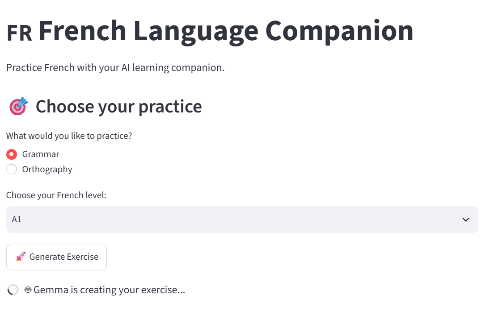

<div align="center">


<br/>


<br/><br/>

<i>🌱 A simple AI-powered French learning companion for grammar and orthography practice.</i>

<br/><br/>

**Hacktoberfest 2026 — Weekend Challenge: Build for a Friend 💜**

</div>

---

<div style="background-color:#f3e5f5; padding:30px; color:black;">

<strong style="font-size:30px;">📋 Description</strong>

<p>
<strong>French Language Companion</strong> is an AI-powered learning application designed to help a French learner practice grammar and orthography.
</p>

<p>
I built it for my younger brother, who struggles with French grammar and spelling.
The goal is to create a simple learning tool where <strong>AI generates exercises, checks answers, and explains mistakes.</strong>
</p>

<p>🤖 The AI runs locally using <strong>Ollama</strong> and <strong>Gemma</strong>.</p>

</div>

---

<div style="background-color:#e8f5e9; padding:30px; color:black;">

<strong style="font-size:30px;">💡 Why I Built It</strong>

<p>
Traditional exercises do not always explain <strong>why</strong> an answer is wrong.
I wanted to create a more personal practice tool that gives useful feedback instead of only showing correct or incorrect.
</p>


</div>

---

<div style="background-color:#fff8e1; padding:30px; color:black;">

<strong style="font-size:30px;">🎯 Main Objectives</strong>

<ul>
<li>📚 Practice French grammar and orthography</li>
<li>🤖 Use open AI technology for learning</li>
<li>🎯 Generate exercises adapted to the learner's level</li>
<li>💡 Explain mistakes and relevant rules</li>
<li>💻 Learn to build a local AI application</li>
</ul>

</div>

---

<div style="background-color:#e3f2fd; padding:30px; color:black;">

<strong style="font-size:30px;">✨ Learning Experience</strong>

<p>The planned learning cycle is:</p>

<p align="center">
👤 <strong>Choose Level</strong>
<br/>↓<br/>
📚 <strong>Choose Practice</strong>
<br/>↓<br/>
🤖 <strong>AI Generates Exercise</strong>
<br/>↓<br/>
✏️ <strong>Answer</strong>
<br/>↓<br/>
🔎 <strong>AI Checks Answer</strong>
<br/>↓<br/>
💡 <strong>Explanation + Rule</strong>
<br/>↓<br/>
📊 <strong>Score / Feedback</strong>
<br/>↓<br/>
➡️ <strong>Next Exercise</strong>
</p>

<p><strong>📖 Practice Areas</strong></p>

<ul>
<li>📚 Grammar</li>
<li>✏️ Orthography</li>
<li>🎧 Dictée <i>(planned)</i></li>
<li>📝 Writing <i>(planned)</i></li>
<li>📊 Progress Tracking <i>(planned)</i></li>
</ul>

</div>

---

<div style="background-color:#fce4ec; padding:30px; color:black;">

<strong style="font-size:30px;">🤖 How the AI Is Used</strong>

<p>AI is part of the learning workflow rather than a separate chatbot.</p>

<ul>
<li>🧠 Generate French exercises</li>
<li>🎯 Adapt exercises to the selected level</li>
<li>🔎 Analyze answers</li>
<li>❌ Identify mistakes</li>
<li>💡 Explain grammar and spelling rules</li>
<li>➡️ Generate further practice</li>
</ul>

<p>
The project uses <strong>Gemma 3 4B</strong> locally through <strong>Ollama</strong>.
</p>

</div>

---

<div style="background-color:#ede7f6; padding:30px; color:black;">

<strong style="font-size:30px;">🛠️ Technology Stack</strong>

<table>
<tr>
<th>Technology</th>
<th>Role</th>
</tr>

<tr>
<td>🐍 <strong>Python</strong></td>
<td>Application logic and AI integration</td>
</tr>

<tr>
<td>🎨 <strong>Streamlit</strong></td>
<td>Web interface</td>
</tr>

<tr>
<td>🦙 <strong>Ollama</strong></td>
<td>Local AI runtime</td>
</tr>

<tr>
<td>🤖 <strong>Gemma 3 4B</strong></td>
<td>AI model</td>
</tr>

<tr>
<td>💻 <strong>VS Code</strong></td>
<td>Development environment</td>
</tr>

<tr>
<td>🔧 <strong>Git / GitHub</strong></td>
<td>Version control and source hosting</td>
</tr>

</table>

</div>

---

<div style="background-color:#e0f2f1; padding:30px; color:black;">

<strong style="font-size:30px;">🎨 User Interface</strong>

<p>
The application uses <strong>Streamlit</strong> to provide a simple browser-based interface.
</p>

<ul>
<li>🇫🇷 French Language Companion interface</li>
<li>📚 Grammar / Orthography selection</li>
<li>🎯 CEFR level selection</li>
<li>🚀 Exercise generation</li>
</ul>

</div>

---

## 📂 Project Structure

```text
french-language-companion/
│
├── 🐍 app.py                 ← Streamlit application
├── 🤖 ai.py                  ← Gemma / Ollama integration
├── 📄 requirements.txt       ← Python dependencies
├── 📖 README.md              ← Project documentation
├── 🔒 .gitignore             ← Files excluded from Git
│
└── 📁 screenshots/
    └── 🖼️ home.png          ← Current interface screenshot
```

> ⚠️ `.venv/` is local only and is excluded from GitHub.

---

<div style="background-color:#e8eaf6; padding:30px; color:black;">

<strong style="font-size:30px;">🚀 Installation & Launch</strong>

<p><strong>1️⃣ Clone the repository</strong></p>

```bash
git clone https://github.com/mounab3/french-language-companion.git
cd french-language-companion
```

<p><strong>2️⃣ Create a virtual environment</strong></p>

```bash
python -m venv .venv
```

<p><strong>3️⃣ Install dependencies</strong></p>

```bash
python -m pip install -r requirements.txt
```

<p><strong>4️⃣ Install and run Ollama</strong></p>

```bash
ollama run gemma3:4b
```

<p><strong>5️⃣ Launch the application</strong></p>

```bash
python -m streamlit run app.py
```

</div>

---

<div style="background-color:#f1f8e9; padding:30px; color:black;">

<strong style="font-size:30px;">🧪 Current Development Status</strong>

<p><strong>🚧 Work in Progress — Hacktoberfest 2026</strong></p>

<p><strong>✅ Completed</strong></p>

<ul>
<li>✅ Project idea and structure</li>
<li>✅ GitHub repository</li>
<li>✅ Python environment</li>
<li>✅ Streamlit interface</li>
<li>✅ Grammar / Orthography selection</li>
<li>✅ CEFR level selection</li>
<li>✅ Ollama installation</li>
<li>✅ Gemma 3 4B installation</li>
<li>✅ Python → Ollama connection</li>
<li>✅AI-generated exercises inside Streamlit</li>
<li>✅ Answer checking</li>
<li>✅ Explanations and rules</li>
<li>✅ Basic scoring</li>
<li>✅ Next exercise functionality</li>
</ul>

</div>

---

<div style="background-color:#fff3e0; padding:30px; color:black;">

<strong style="font-size:30px;">🔮 Future Improvements</strong>

<ul>
<li>🎧 AI-powered dictée with audio</li>
<li>📝 Short writing exercises</li>
<li>📊 Personal progress tracking</li>
<li>🧠 Recurring mistake tracking</li>
<li>🎯 More detailed level adaptation</li>
<li>🔊 Text-to-speech</li>
<li>🎨 Improved interface</li>
<li>🌐 Possible online deployment</li>
</ul>

</div>

---

<div style="background-color:#f3e5f5; padding:30px; color:black;">

<strong style="font-size:30px;">🌍 Why Open Innovation Matters</strong>

<p>
Open-source and open-weight AI give students and independent developers the opportunity to experiment with AI and build useful applications using accessible technologies.
</p>

<p>
For this project, a local AI model makes it possible to explore AI-assisted learning without relying entirely on a closed platform.
</p>

</div>

---

<div style="background-color:#e3f2fd; padding:30px; color:black;">

<strong style="font-size:30px;">🏆 Hacktoberfest 2026</strong>

<p>
This project was created for the <strong>Hacktoberfest 2026 Weekend Challenge — Build for a Friend.</strong>
</p>

<p>
I built it for someone close to me who needs extra support with French grammar and orthography.
</p>


</div>

---

<div style="background-color:#e8f5e9; padding:30px; color:black;">

<strong style="font-size:30px;">📸 Screenshots</strong>

<br/><br/>

<div align="center">



<br/>

<i>🇫🇷 Current Streamlit interface</i>

</div>

</div>


---

<div style="background-color:#fce4ec; padding:30px; color:black;">

<strong style="font-size:30px;">📝 Hacktoberfest Submission</strong>

<p><strong>What I Built</strong><br/>
An AI-powered French learning companion for grammar and orthography practice.
</p>


<p><strong>Code</strong><br/>
The complete source code is available in this repository.
</p>

<p><strong>How I Built It</strong><br/>
🐍 Python • 🎨 Streamlit • 🦙 Ollama • 🤖 Gemma • 🔧 Git/GitHub
</p>

<p><strong>Why Does Open Innovation Matter?</strong><br/>
Open AI technologies give students and independent developers opportunities to experiment, learn, and build useful applications.
</p>


</div>

---

<div style="background-color:#e0f7fa; padding:30px; color:black;">

<strong style="font-size:30px;">📚 What I Learned</strong>

<ul>
<li>🎨 Building an application with Streamlit</li>
<li>🤖 Connecting Python to a local AI model</li>
<li>🦙 Using Ollama to run AI locally</li>
<li
<li>🌱 Building around a real-world problem</li>
</ul>

</div>

---

<div style="background-color:#eeeeee; padding:25px; color:black;">

<strong style="font-size:30px;">👩‍💻 Author</strong>

<br/><br/>

<strong>Mouna</strong>
Computer Science Student


Built with Python, curiosity, and open-source AI 

</div>

---

<div align="center">

<br/>


<br/><br/>

 **Learn • Practice • Improve • Repeat 🔁**

</div>
